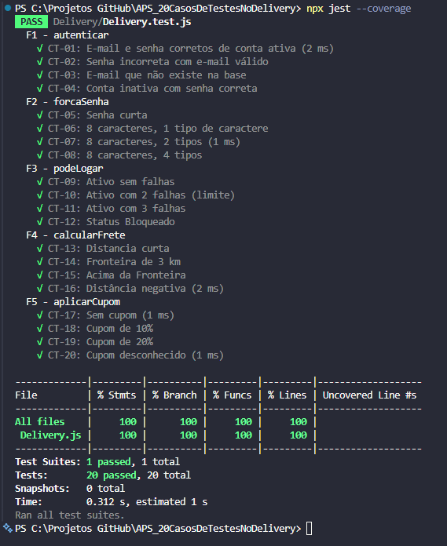

# DeliveryExpress --- Testes Automatizados

## Integrantes do grupo

-   Eric Botelho Santos
-   Gabriel Henrique Siebra Uchoa
-   Eric Oliveira Araújo

## Enunciado resumido

O **DeliveryExpress** é um sistema de delivery que precisa passar por
uma camada de testes automatizados antes de ser disponibilizado em
produção.

Nesta APS, a equipe deve:

1.  Implementar **20 casos de teste** no arquivo `delivery.test.js`,
    utilizando o framework **Jest** e os critérios de aceitação
    especificados.
2.  Implementar as **5 funções** do arquivo `delivery.js`, ajustando o
    código até que todos os testes sejam aprovados.
3.  Alcançar **100% de cobertura de testes**.

## Executar os testes

No terminal, dentro da pasta do projeto, execute:

``` bash
npx jest --coverage
```

O comando executa os testes e apresenta o relatório de cobertura do
código.

## Evidência da execução


